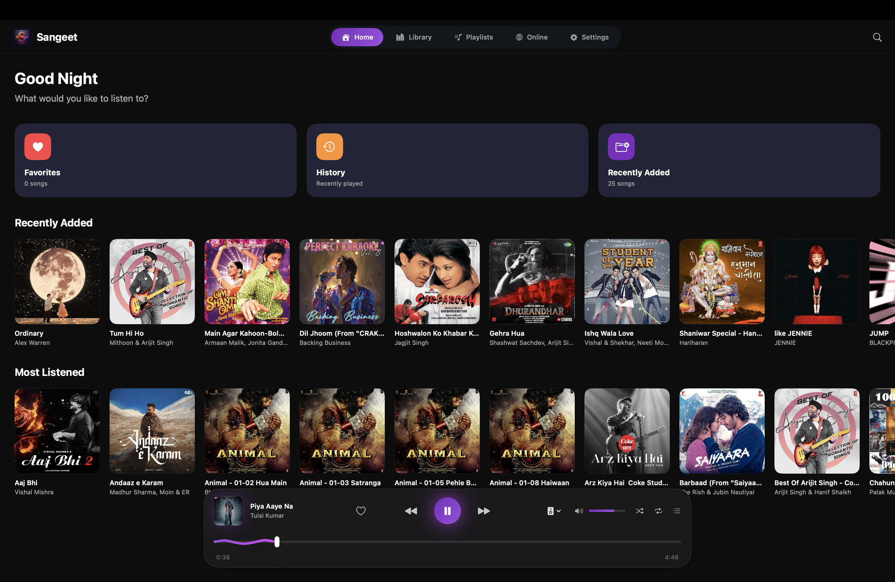
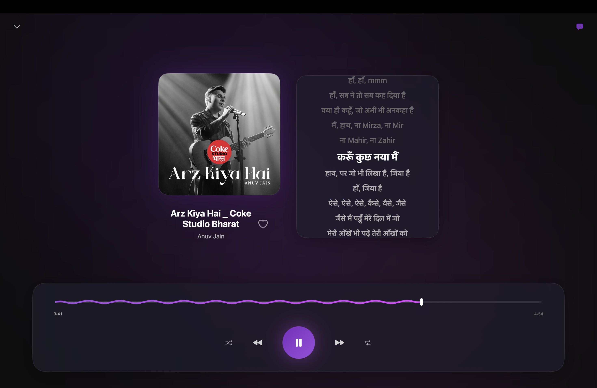
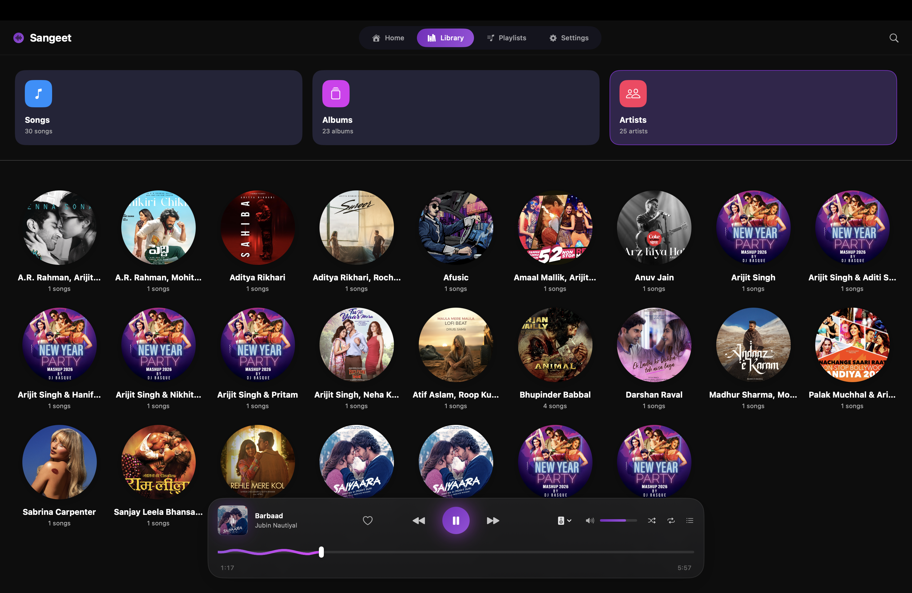
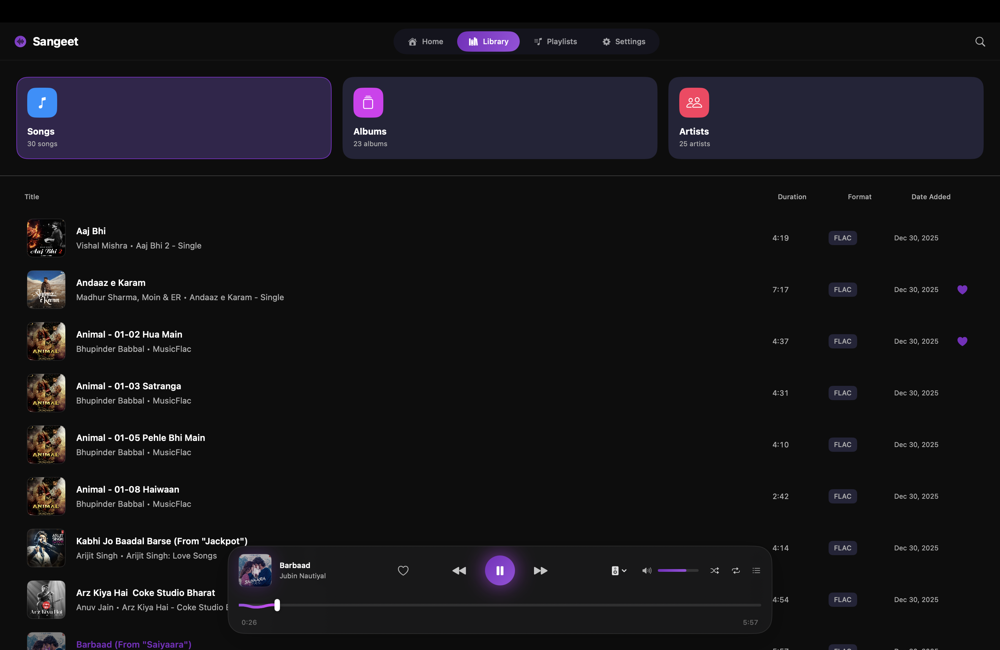
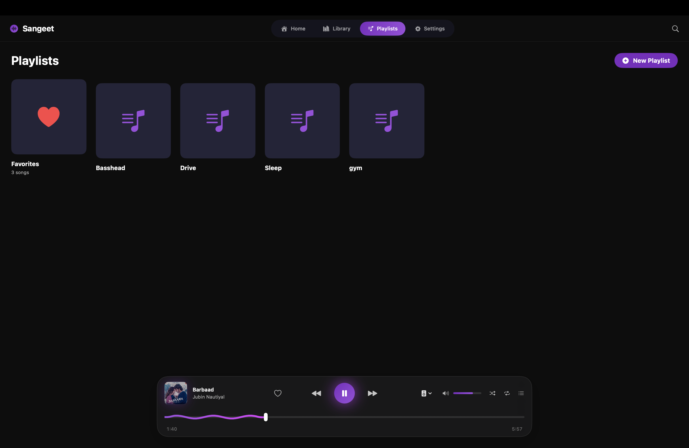
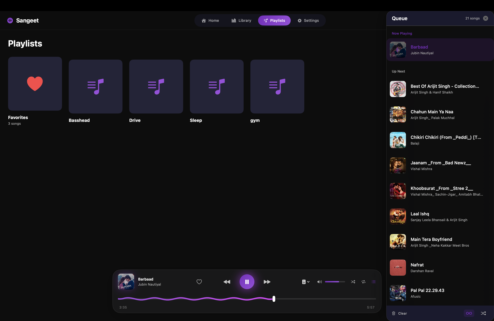
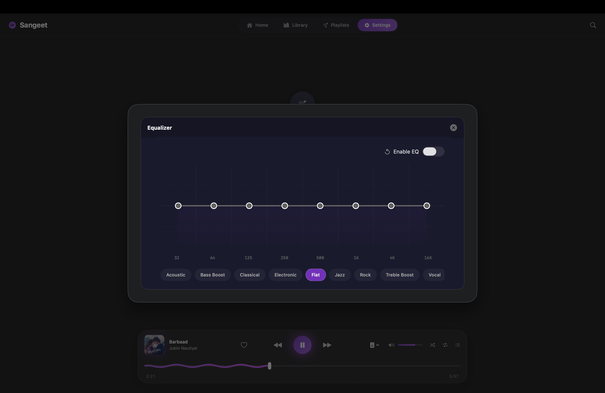
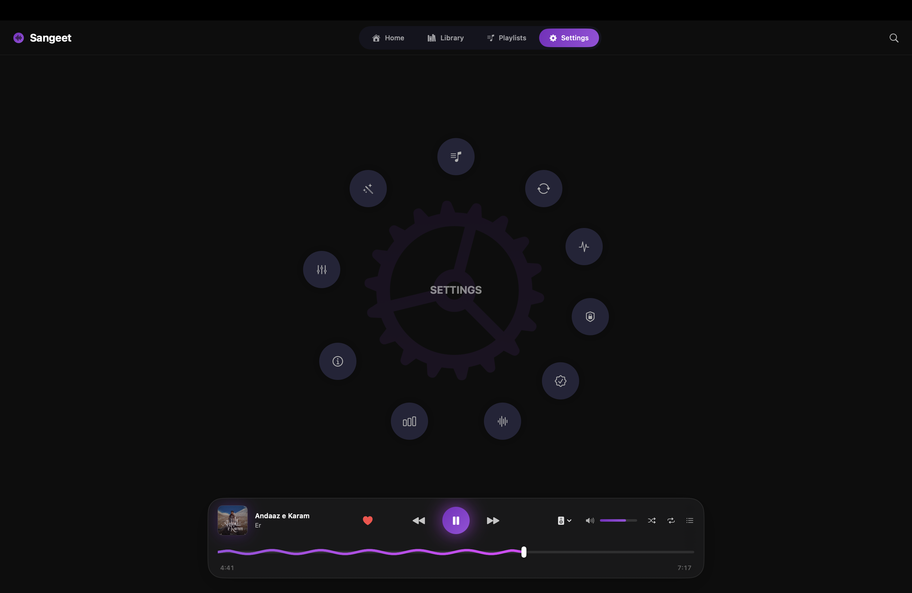

# Sangeet v3.4.0 - The Offline-First Audiophile Player

> "Your music. Your device."


Sangeet is a premium, native macOS music player built for audiophiles who demand bit-perfect audio quality without compromising on aesthetics. Powered by the industry-standard **BASS Audio Engine** and wrapped in a stunning **Glassmorphic SwiftUI** interface, Sangeet bridges the gap between professional audio tools and modern design.

Sangeet is **offline-first**: playback, your library, listening history, and taste profile all live on your Mac and work without internet. The only network feature is optional lyrics fetching — and once fetched, lyrics are cached locally for offline use.

---

## ✨ Key Features

### 🎧 Audiophile-Grade Audio Engine
- **Bit-Perfect Output**: Bypasses the macOS system mixer to deliver unaltered audio directly to your DAC.
- **Exclusive Access (Hog Mode)**: Takes complete control of your audio device to prevent interference from other apps.
- **Native Sample Rate Switching**: Automatically adjusts your DAC's sample rate to match the source file (up to 192kHz/32-bit).
- **True Gapless Playback**: Zero-latency transitions between tracks using advanced preloading.
- **Smart Crossfade**: "Kill Switch" technology ensures smooth transitions without overlapping clashes, even during rapid skipping.
- **Volume Normalization**: Integrated ReplayGain support for consistent volume levels across your library.

### 🎨 Stunning Visuals
- **Glassmorphism UI**: Beautiful, translucent interface elements that blend with your desktop.
- **Floating Dock**: A compact, interactive mini-player that floats above your windows.
- **Visual Equalizer**: 8-band parametric EQ with a glowing, interactive curve and preset management.
- **Squiggly Progress Bar**: Unique, animated playback progress inspired by Android 13.
- **Radial Settings Menu**: A futuristic, gesture-driven settings interface.

### 📂 Powerful Library Management
- **Folder-Based Library**: Drag and drop your music folders directly—no "importing" or duplicating files.
- **Instant Search**: Global Cmd+K search to find any track, album, or artist instantly.
- **Local Metadata**: Reads tags and artwork straight from your files (with folder-art fallback).
- **Infinite Queue & Radio**: Never stops playing - similar tracks from your own library are queued automatically, ranked by a local taste profile.
- **Stats & History**: Track your listening habits with detailed statistics.

### 🎤 Immersive Karaoke
- **Word-by-Word Sync**: Fetches word-synced lyrics online (LyricsPlus, with LRCLib line-sync fallback) for a true karaoke experience.
- **Offline-First Lyrics**: Local `.lrc` sidecar files (including enhanced word timing), `.txt` files, and lyrics embedded in your audio tags always take priority — and every fetched lyric is cached on disk for offline replay.
- **Immersive UI**: Beautiful, full-screen overlay mode that blends lyrics with the album art background.
- **Persistent State**: Lyrics visibility preference is remembered across sessions.

### 🔒 Offline-First & Private
- **Playback never needs internet**: Your music plays entirely from local files; lyrics fetching is the app's only network feature.
- **Local Smart Queue**: The "Radio" and Infinite Queue features are powered entirely by your own library and a local, on-device taste profile.
- **Your data stays yours**: Play counts, favorites, and listening history live in a local SQLite database. No accounts, no analytics, no tracking.

---

## 📸 Screenshots

| Home & Full Player | Library (Artists & Albums) |
|:---:|:---:|
|  <br>  |  <br>  |

| Songs & Playlists | Queue & Visual EQ |
|:---:|:---:|
|  <br>  |  <br>  |

| Settings & Extras | |
|:---:|:---:|
|  | |


---

## 🛠️ Technology Stack
- **Language**: Swift 6.0
- **UI Framework**: SwiftUI (macOS 14+)
- **Audio Engine**: [Un4seen BASS](https://www.un4seen.com/) (C++ Library bridged to Swift)
- **Database**: [GRDB.swift](https://github.com/groue/GRDB.swift) (SQLite wrapper)
- **Hardware Integration**: CoreAudio (for HAL/DAC control)

---

## 🏗️ Installation & Build

1. **Clone the repository**
   ```bash
   git clone https://github.com/YashvardhanATRgithub/Sangeet.git
   cd Sangeet
   ```

2. **Open in Xcode**
   ```bash
   open Sangeet3.xcodeproj
   ```

3. **Build & Run**
   - Ensure you have the `libbass.dylib` in `Data/Audio/BASS/` (included in repo).
   - Press `Cmd+R` to build and run.

---

## 🙌 Acknowledgements

Special thanks to the creators of the libraries and services that make Sangeet possible:

- **[Un4seen Developments](https://www.un4seen.com/)**: For the incredible **BASS Audio Library**, which powers the core audio engine, DSP, and gapless playback features.
- **[Gwendal Roué](https://github.com/groue)**: For **GRDB.swift**, the robust SQLite toolkit that handles the music library database.
- **Apple**: For SwiftUI and CoreAudio.

---

**Made with ❤️ by Yashvardhan**
